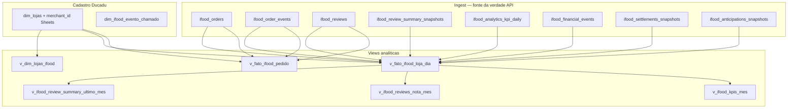

# Modelagem analítica iFood (Ducadu)

Camada de **views** sobre o ingest Neon (`sql/001`–`005`) e **`dim_lojas`** (Google Sheets, [`sql/007_dim_lojas_merchant_id.sql`](../sql/007_dim_lojas_merchant_id.sql)). Metas e score gerencial ficam no **Central Ducadu** (Gabriel).

**DDL views:** [`sql/006_ifood_marts.sql`](../sql/006_ifood_marts.sql)  
**DDL de-para iFood:** [`sql/007_dim_lojas_merchant_id.sql`](../sql/007_dim_lojas_merchant_id.sql)  
**Ingest de-para:** `lambda/src/ingest/sheets.py` — aba `de-para lojas`, coluna `merchant_id` (UUID iFood).

Não há materialized views nem `refresh_ifood_marts()`. Metas mensais e score 4×25% **não** ficam em tabelas Neon.

---

## 1. Camadas



| Camada | Papel |
|--------|--------|
| **Ingest** | Payloads e fatos finos; não alterar só para o dashboard. |
| **`dim_lojas`** | Nome da loja (`loja`), id Saipos/operacional (`id`), **`merchant_id`** iFood — de-para no Sheets. |
| **`dim_ifood_evento_chamado`** | Padrões `LIKE` em eventos que contam como **chamado** até o iFood confirmar Selo. |
| **Views** | Joins prontos para BI e consumo pelo front (Central). |

---

## 2. De-para loja ↔ iFood

### `dim_lojas.merchant_id`

| Coluna | Descrição |
|--------|-----------|
| `id` | Id da loja no de-para (ex.: Saipos / operação) |
| `loja` | Nome exibido |
| `merchant_id` | UUID merchant iFood — **obrigatório para nome correto nas views** |

Preencher na planilha (aba **de-para lojas**) e rodar ingest Sheets. Sem `merchant_id`, as views ainda agregam por `merchant_id` do pedido, mas `loja_nome` cai no UUID ou `merchant_name` do ingest.

### `v_dim_lojas_ifood`

Lista enxuta `loja_id`, `loja_nome`, `merchant_id` onde o de-para existe — útil para joins com `sales_status_histories` (`id_store` = `loja_id`) e APIs iFood (`merchant_id`).

---

## 3. Views de fato

### `v_fato_ifood_pedido` (grão: **1 pedido**)

| Grupo | Colunas principais |
|-------|-------------------|
| Identificação | `pedido_id`, `merchant_id`, `loja_id`, `loja_nome`, `sales_date`, `short_id` |
| Venda | `canal`, `tipo`, `categoria`, `status_atual`, `valor_venda`, `valor_pagamento` |
| Flags (Financial) | `flag_cancelado`, `flag_concluido` — `%CANCEL%`, `%CONCLUD%` |
| Chamados | `flag_chamado` — eventos × `dim_ifood_evento_chamado` |
| Eventos | `qtd_eventos`, `ultimo_evento_*` |
| Review | `review_id`, `nota_review`, `tem_comentario` |

### `v_fato_ifood_loja_dia` (grão: **loja × `data_referencia`**)

| Coluna | Origem / regra |
|--------|----------------|
| `pedidos_total`, `pedidos_cancelados`, `pedidos_concluidos` | `ifood_orders` por `sales_date` |
| `taxa_cancelamento_pct_financial` | % com denominador total ou (concluídos + cancelados) |
| `pedidos_com_chamado`, `taxa_chamados_pct_eventos` | Eventos × padrões de chamado |
| `gmv_*`, `ticket_medio_concluidos` | Financial Sales |
| `reviews_qtd`, `nota_media_dia` | `ifood_reviews` |
| `review_summary_raw` | Snapshot Review summary |
| `kpi_*_analytics` | `ifood_analytics_kpi_daily` |
| `saldo_settlement`, `saldo_anticipation`, `eventos_financeiros_*` | 005 / financial events |

**Pedidos para metas operacionais iFood:** colunas **Financial** (`pedidos_*`, `taxa_cancelamento_pct_financial`). Analytics em paralelo para comparação com Portal.

---

## 4. Views agregadas (mês)

| View | Grão | Uso |
|------|------|-----|
| `v_ifood_kpis_mes` | loja × mês | Pedidos, cancelamentos, chamados (eventos), GMV |
| `v_ifood_reviews_nota_mes` | loja × mês | **Nota iFood mês Ducadu** — média ponderada por `reviews_qtd` |
| `v_ifood_review_summary_ultimo_mes` | loja × mês | Último JSON de summary no mês (nota app ~3m — parse no app) |

Metas, NPS Falaê, nota nutricionista e **score 4×25%** não estão no Neon; o Central combina esses insumos com as views acima (ou APIs diretas) no front.

---

## 5. Indicadores × modelo

| Indicador | Onde ler | Coberto no Neon? |
|-----------|----------|------------------|
| Pedidos total (período) | `v_ifood_kpis_mes` / `v_fato_ifood_loja_dia` | Sim |
| Tendência D-1 por dia | `v_fato_ifood_loja_dia` | Sim |
| Cancelados n e % | Financial nas views; Analytics em `kpi_*_analytics` | Sim (validar vs Selo) |
| Concluídos | `pedidos_concluidos` | Sim |
| Chamados n e % | `pedidos_com_chamado`, `taxa_chamados_pct_eventos` | Parcial — padrões de evento |
| Saldo / GMV | `gmv_sale_balance` / `v_fato_ifood_pedido` | Sim |
| Nota app (summary) | `v_ifood_review_summary_ultimo_mes` | Sim |
| Nota mês Ducadu | `v_ifood_reviews_nota_mes` | Sim |
| Metas / score 4×25% | Central (Gabriel) | **Fora do Neon** |
| NPS Falaê / nutricionista | Central / planilhas | **Fora do Neon** |

---

## 6. Operação

### Aplicar migrations

Aplicar no Neon (SQL Editor ou CLI), nesta ordem: `007_dim_lojas_merchant_id.sql` → `006_ifood_marts.sql`.

### Ingest iFood local (mesmo código da Lambda)

Na raiz do repo, com `.env` e `AWS_PROFILE` após `aws sso login`:

```powershell
python scripts/run_ingest_local.py
python scripts/run_backfill_local.py
```

Variáveis úteis: `IFOOD_INGEST_START_DATE`, `IFOOD_INGEST_END_DATE`, `IFOOD_BACKFILL_YEAR`, `IFOOD_BACKFILL_FROM_MONTH`, `IFOOD_BACKFILL_TO_MONTH`.

### Manter de-para

1. Coluna `merchant_id` na aba **de-para lojas** do Sheets.
2. Rodar ingest Sheets (`lambda` ou job local).

### Ajustar regra de chamados

```sql
INSERT INTO dim_ifood_evento_chamado (pattern, descricao)
VALUES ('%NOVO_PADRAO%', 'Descrição')
ON CONFLICT (pattern) DO NOTHING;
```

---

## 7. Evolução prevista

| Item | Ação |
|------|------|
| MVs / refresh | Só se volume ou latência exigirem; hoje views only |
| Pivot financeiro por `event_name` | View opcional sobre `ifood_financial_events` |
| Chamados Selo | Atualizar `dim_ifood_evento_chamado` ou ingest Order |
| Join Saipos | `v_dim_lojas_ifood.loja_id` ↔ `sales_status_histories.id_store` |

---

## 8. Referências no repositório

| Artefato | Caminho |
|----------|---------|
| Ingest iFood | `lambda/src/ingest/ifood.py` |
| Ingest Sheets | `lambda/src/ingest/sheets.py` |
| Ingest / backfill local | `scripts/run_ingest_local.py`, `scripts/run_backfill_local.py` |
| Tabelas raw | `sql/001_ifood_tables.sql`, `004`, `005` |
